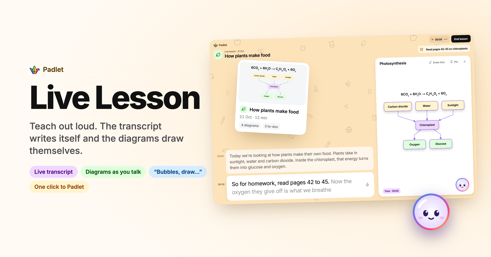
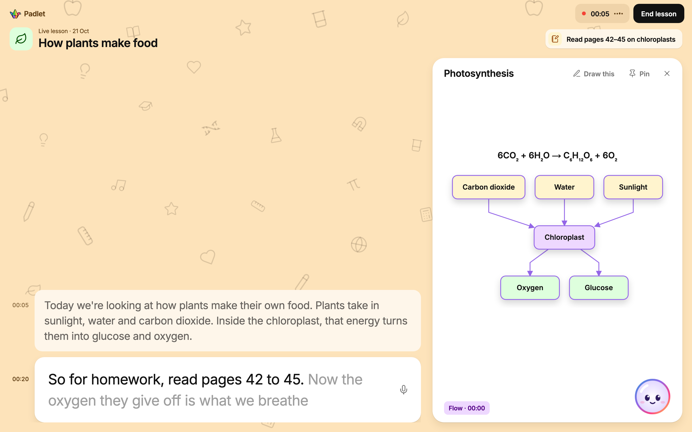
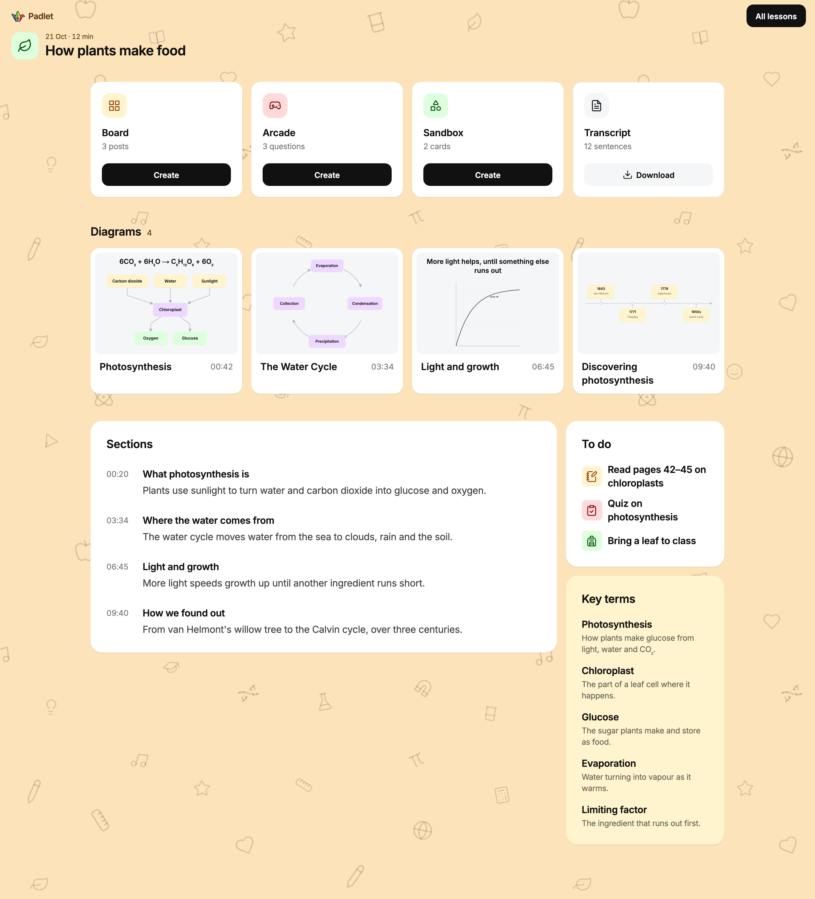
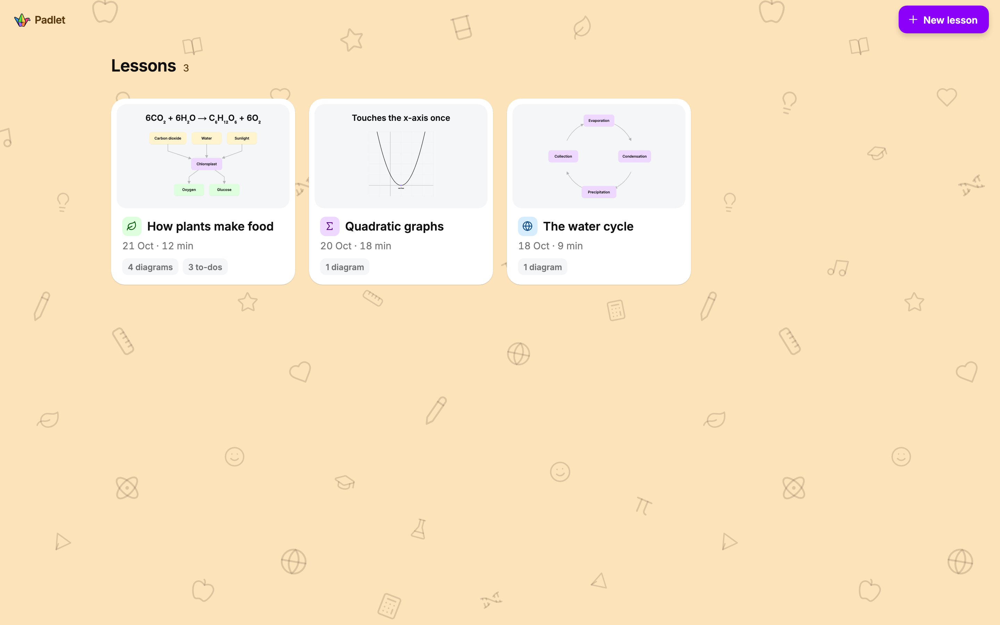

<p align="center">
  
</p>

<h1 align="center">Live Lesson</h1>

<p align="center">
  <b>Teach out loud. The transcript writes itself and the diagrams draw themselves.</b><br>
  A live classroom view for Padlet: speech to text as the teacher talks, diagrams drawn from what they explain,<br>
  and one click at the end to draft a Padlet Board, Arcade quiz or Sandbox deck from the lesson (mocked for now).
</p>

<p align="center">
  
  
  
  
  
  
</p>

<p align="center">
  <a href="https://padlet-live-lesson.vercel.app"><b>Try it live →</b></a>
</p>

> [!NOTE]
> Built as a take-home for Padlet. Transcription and diagrams are real; the hand-off to Padlet is mocked, since there's no public API to create boards, Arcade games or Sandboxes. Lessons are saved in the browser, not on a server.

## What it does

- **Live transcript.** The browser streams the microphone to a GPU on Modal. Words appear as they're spoken, and each sentence is tidied once it's finished (fillers gone, mis-heard terms fixed, nothing added). Teachers can click any sentence to correct it.
- **Diagrams as you talk.** When the teacher explains something drawable, a diagram appears beside the transcript and grows as they go: flow charts, cycles, timelines, function graphs and geometry, and molecules. Earlier diagrams are filed into the transcript at the moment they were drawn.
- **"Bubbles, draw…"** Bubbles, the mascot in the corner, listens for its name. "Bubbles, draw the water cycle" draws a new diagram; "Bubbles, write the formula underneath" adds to the one on screen.
- **Student to-dos.** "For homework, read pages 42 to 45" becomes a to-do pill on screen and in the summary.
- **Saved lessons.** Each lesson keeps its transcript, diagrams, sections and key terms. Diagrams download as SVG or PNG and the transcript as text.
- **Drafts for Padlet.** From the summary, a lesson becomes a Board (wall, columns or timeline), an Arcade quiz or a Sandbox deck, each with an editable preview. Creating it is mocked: the demo shows what Padlet would receive.

## Screenshots

**During the lesson.** The transcript fills from the bottom while the diagram on the right is drawn from what's been said.



**A saved lesson.** Sections, key terms, to-dos and every diagram, with Board, Arcade and Sandbox one click away.



<details>
<summary>All lessons</summary>


</details>

## How it works

1. **Speech.** An AudioWorklet turns the mic into 16 kHz PCM and sends it over a WebSocket straight to [Nemotron streaming](https://huggingface.co/nvidia/nemotron-speech-streaming-en-0.6b) on a Modal L4 (`stt/`). Audio said while the GPU wakes up is held in the browser and caught up in one go, so the first words of a lesson aren't lost.
2. **Tidy-up.** Each finished sentence goes to `/api/clean`, which uses a fast LLM with the previous sentences as context. It also picks out homework, tests and things to bring.
3. **Should we draw, and what?** `/api/diagram` asks Jev, a yes/no and multiple-choice model, whether the last few sentences are worth a diagram, which kind fits, and whether the topic is still the one on screen. "Draw this" and "Bubbles, …" skip the first question.
4. **Drawing.** Only then does the LLM run, returning typed edits ("add a node", "add an edge", "set the axes") rather than drawing code. They're validated and drawn by our own SVG renderers, so every diagram is in Padlet's style and there's no drawing syntax for the model to get wrong.
5. **End of lesson.** `/api/export` makes one pass over the whole transcript to write sections, key terms and the Board, Arcade and Sandbox drafts.

API keys never reach the browser: every LLM and Jev call goes through a Next.js route.

## Run it locally

You need Node, a [Modal](https://modal.com) account, an [OpenRouter](https://openrouter.ai) key and a [TypeSafe](https://typesafe.ai) (Jev) key.

```bash
# 1. Speech server on Modal
pip install modal
modal setup                                   # log in once
cd stt && modal deploy -m nemotron_asr.nemotron_asr && cd ..
# Of the URLs it prints, use the one for live-lesson-stt-nemotronasr-webapp, as wss://…/ws

# 2. The app
cd web
cat > .env.local <<'EOF'
NEXT_PUBLIC_STT_WS=wss://<your-modal-app>.modal.run/ws
OPENROUTER_API_KEY=...
TYPESAFE_API_KEY=...
EOF
npm install
npm run dev   # http://localhost:3000
```

The GPU shuts down after 5 minutes idle, so the first lesson of the day waits for it to start. The app shows a warming screen meanwhile and keeps what's said.

## Repository

| Path | What's there |
|---|---|
| `web/` | The Next.js app: live lesson, summary and dashboard (`components/`), lesson state (`lib/useLesson.ts`), diagram ops and renderers (`lib/diagram.ts`, `components/Diagram.tsx`), API routes (`app/api/`) |
| `stt/` | The Modal speech server, adapted from Modal's Nemotron example |
| `design/` | The UI mockups the app was built from |
| `architecture.png`, `architecture-scale.png` | Early architecture boards, drawn before the build (some details changed since: an L4 GPU, own SVG renderers), and how it would run at Padlet's scale |
| `padlet-integration-brief.md` | What Board, Arcade and Sandbox expect from a lesson |
| `PLAN.md` | The original plan and decisions |
